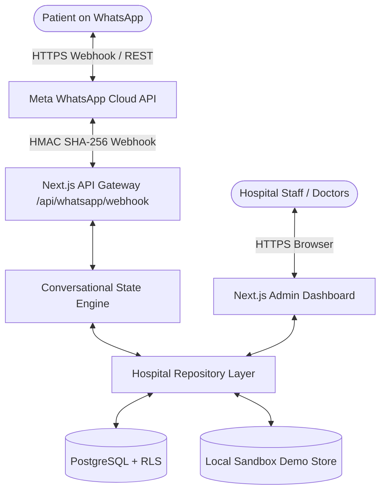
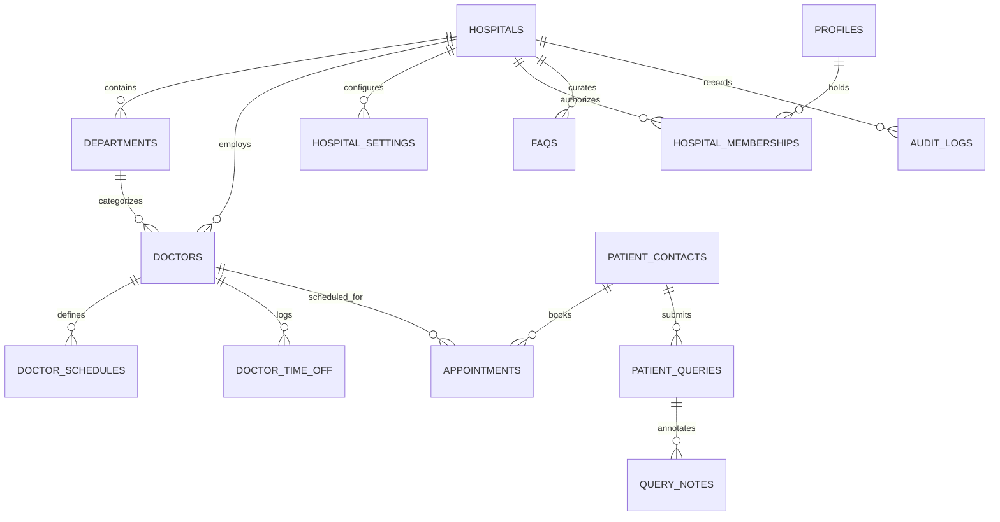

# MediConnect System Architecture & Design Specification

## 1. Overview

**MediConnect** is an enterprise-grade hospital automation platform engineered to bridge healthcare delivery systems with patient-friendly communication channels via the **Meta WhatsApp Business Platform Cloud API (v21.0)**.

---

## 2. Request Flow

### A. Inbound Patient Message (WhatsApp)
1. **User Interaction**: Patient sends a message on WhatsApp or taps an interactive quick-reply button.
2. **Meta Cloud API**: Meta sends an HTTP POST event to `https://<domain>/api/whatsapp/webhook`.
3. **Webhook Verification**:
   - Validates `x-hub-signature-256` HMAC SHA-256 header using `WHATSAPP_APP_SECRET` and `crypto.timingSafeEqual`.
   - Rejects unverified requests with HTTP 401.
4. **Event Deduplication (Idempotency)**:
   - Checks `whatsapp_webhook_events` for existing `event_id` to prevent double processing during Meta delivery retries.
5. **State Machine Processing**:
   - Retrieves active `ConversationSession` using the patient's normalized phone number (`+91...`).
   - If session is under `is_human_handover`, routes to staff queue unless user types "MENU".
   - Executes deterministic intent matching and workflow steps.
6. **Database Reservation**:
   - For appointment bookings, executes atomic concurrency check against `appointments`, `doctor_schedules`, and `doctor_time_off`.
   - Generates unique reference code (`APT-YYYYMMDD-XXXX`).
7. **Outbound Confirmation**:
   - Calls Meta Graph API endpoint `https://graph.facebook.com/v21.0/<PHONE_NUMBER_ID>/messages` with formatted interactive buttons or confirmation text.

---

## 3. Database Entity Relationships

---

## 4. Key Architectural Safeguards

1. **Atomic Concurrency (Zero Double-Booking)**:
   - Slot reservation checks availability and acquires lock inside the repository/PostgreSQL function (`book_appointment_slot`).
   - Partial unique index on `appointments(doctor_id, appointment_date, start_time) WHERE status != 'cancelled'`.

2. **Dual-Mode Repository (Graceful Offline Execution)**:
   - If Supabase credentials are missing or invalid, automatically activates an in-memory transactional demo store initialized with realistic hospital data.
   - Zero application crashes on fresh clone or local development.

3. **Multi-Tenant Hospital Isolation**:
   - Every operational table contains `hospital_id`.
   - Supabase Row Level Security (RLS) policies enforce `has_hospital_access(hospital_id)` on all authenticated queries.
